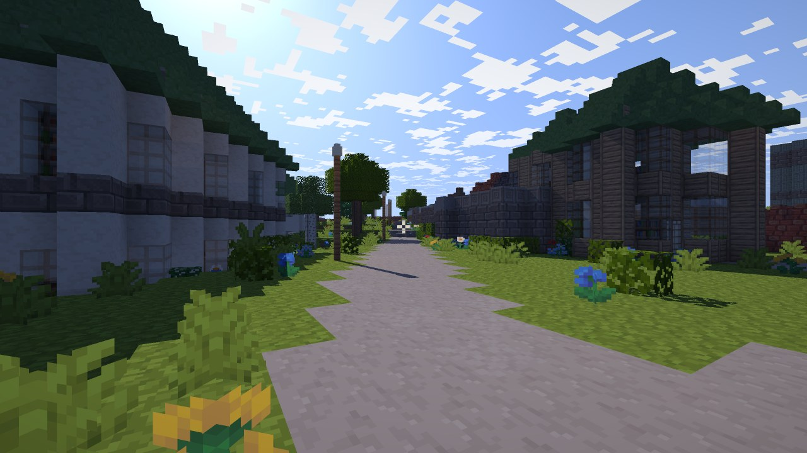
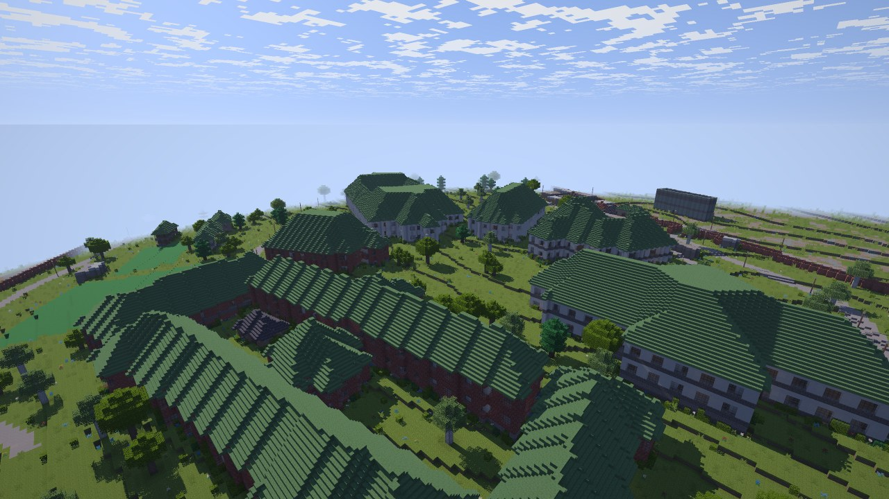
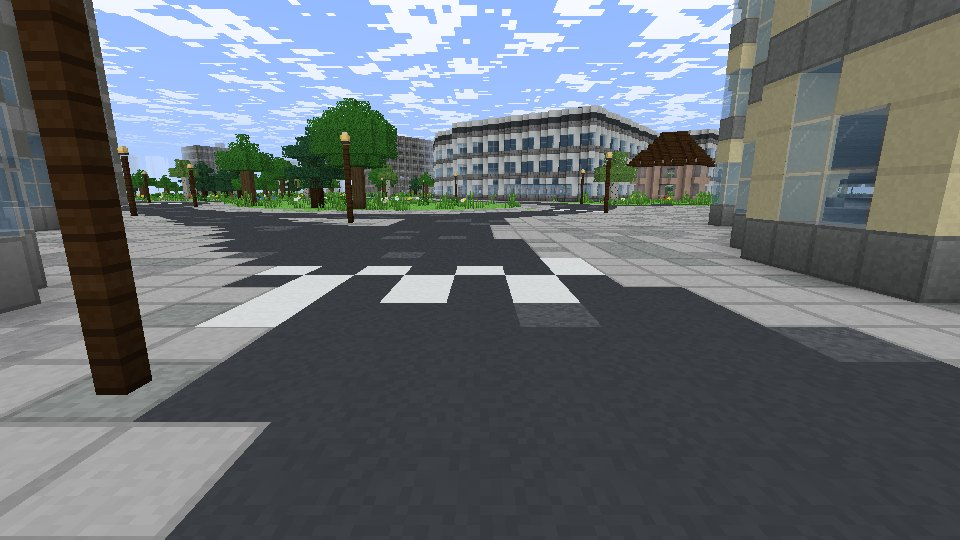
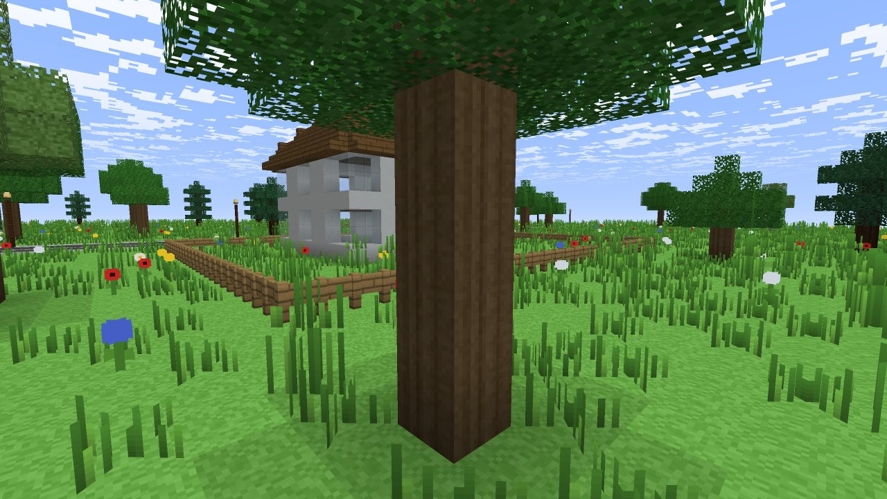

# place2mc

Pick any real place on a map, press Convert, and walk around it like you are in Minecraft. place2mc downloads the
streets, buildings, water, parks and trees from OpenStreetMap and the hills from public elevation data, and builds
them at 1 block = 1 metre. You get a walk-through that opens in any browser (no Minecraft needed), a ready-to-play
Java world, and a Bedrock `.mcworld` file.



| | |
|---|---|
|  |  |
|  |  |

These pictures are made by place2mc itself (`mcrender.py`), drawn the way the game draws a world at noon. On a
computer with Minecraft Java installed, the pictures and the walk-through use the textures of your own game;
otherwise they use the Minecraft-style Pixel Perfection CE textures that come with place2mc.

## Use it

1. Install Python 3 from [python.org](https://www.python.org/downloads/) (on Windows, tick "Add python.exe to PATH").
2. Download this repository (green **Code** button, **Download ZIP**) and unzip it.
3. Double-click **start-windows.bat** (Windows) or **start-mac.command** (Mac). A page opens in your browser.
4. Search for a place or click on the map, choose the size and the edition, and press **Convert**.
5. When it says Done:
   - **Walk around**: press **Walk around** and walk with W A S D and the mouse, right in the browser. The file
     `Walk around <name>.html` in the world folder does the same on any computer or phone: just open it.
   - **Java**: open Minecraft, go to Singleplayer, and the new world is in the list. You start on a street in the middle.
   - **Bedrock**: press **Add to Bedrock** (on Windows, Minecraft opens and imports the world), or send the
     `.mcworld` file to your phone or tablet and open it there.

New worlds are Creative, Peaceful, always noon, with no mobs, and empty around the built square.

| Edition | Works with |
|---|---|
| Java | 1.21.4 or newer for new worlds; 1.18 to 1.21.3 with `--world` (build into a Superflat world you made) |
| Bedrock | 1.21.120 or newer on Windows, Android, iPhone and iPad (anything that opens a `.mcworld` file) |

## Command line

```
pip install numpy pillow
python place2mc.py "Needham, Massachusetts"                       # new Java world
python place2mc.py "Needham, Massachusetts" --edition both --screenshots
python place2mc.py --center 51.5007,-0.1246 --radius 500 --edition bedrock
```

To make a place look more like itself, give it the colours and materials the map doesn't have yet:
`--tags file.json` adds building colours, wall and roof materials, roof shapes and floors (see
`examples/ala/ala-tags.json`, made from African Leadership Academy's campus photos). Tags already on
OpenStreetMap (`building:colour`, `building:material`, `roof:colour`, `roof:material`, `roof:shape`,
`building:levels`) are used automatically.

Other options: `--osm-file map.osm` (work offline from a saved map), `--flat` (no hills), `--preview-only`,
`--textures PATH` (a game .jar or resource pack for the pictures). `python place2mc.py --help` lists them all.

## Example

[`examples/ala`](examples/ala): African Leadership Academy in Johannesburg, with a walk-through you can download
and open.

## Where the map is thin

OpenStreetMap is detailed in many cities but thin in many places (African Leadership Academy has 11 of its
buildings on it). So place2mc also reads **Overture Maps**, a free worldwide map that adds buildings found in
aerial imagery (Microsoft, Google) and Esri's community maps, with heights, floors and roof details where known,
and **ESA WorldCover** land cover (forest, shrubs, crops, bare ground) seen from space. It only adds what
OpenStreetMap does not have, and never replaces it. Turn it off with `--no-overture`.

## What it builds

- Hills from elevation data, with dirt over stone, and the sea, lakes and rivers at their real places
- Buildings at their mapped height (or a guess from their type and size), in the colours and materials the map
  gives (brick, plaster, concrete, wood, green or red metal roofs, ...): walls with windows and floors
  inside, shop windows on the street side, doors, flat roofs with rooftop units, sloped roofs with eaves
- Roads at their real width with sidewalks, centre lines, zebra crossings, street lamps, and half slabs where
  a street climbs
- Fences, garden walls and hedges, railway and tram tracks, benches
- Parks, forests, lawns, street trees and mapped trees, grass and flowers, and the matching biomes

## How it was checked, and what was not

The worlds were read back block by block with independent readers: nbtlib and anvil-parser2 for Java,
and for Bedrock a separate Python reader plus rusty-leveldb (the database library Arnis uses). Every block
name and state was checked against the game's own block lists from PrismarineJS/minecraft-data for Java 1.18,
1.21.4 and Bedrock 1.21.120. The app was tested end to end in a browser.

Not checked yet: opening the worlds in the real game (the computer this was built on has no Minecraft),
live map and elevation downloads (it had no access to those servers; tests used saved map files and test
elevation tiles), and the game's own textures for the pictures.

## Credits

- Map data © [OpenStreetMap](https://www.openstreetmap.org/copyright) contributors (ODbL). Worlds built from
  it contain OpenStreetMap data, so credit it if you share them.
- Buildings the map lacks: [Overture Maps Foundation](https://overturemaps.org) (ODbL); land cover from
  [ESA WorldCover](https://esa-worldcover.org) (CC BY 4.0), through Overture's base theme. The way to read them
  (PMTiles over HTTP) follows Arnis.
- Elevation: Terrain Tiles on AWS (Mapzen / Tilezen), from SRTM, USGS and other public sources.
- Textures for the pictures and the walk-through when Minecraft is not installed: [Pixel Perfection CE](https://github.com/Athemis/PixelPerfectionCE)
  by XSSheep and contributors, CC BY-SA 4.0 (see `textures/pixel-perfection-ce/CREDITS.md`).
- Map in the app: [Leaflet](https://leafletjs.com) (BSD-2-Clause, licence in `app/leaflet/LICENSE`).
- [Arnis](https://github.com/louis-e/arnis) (Apache-2.0) does the same job in more detail; its Bedrock worlds
  were the reference for the Bedrock file layout and settings used here.
- Block lists for the tests: [PrismarineJS/minecraft-data](https://github.com/PrismarineJS/minecraft-data).
- No Minecraft files are included or copied. Not an official Minecraft product; not approved by or associated
  with Mojang or Microsoft.
