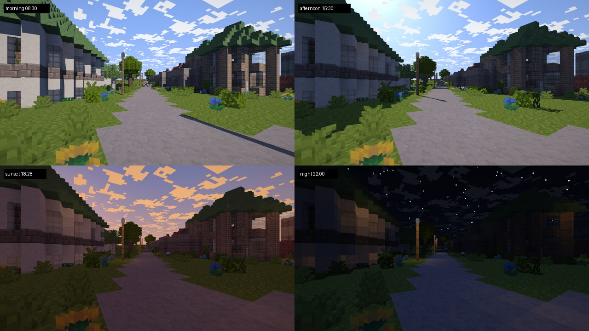
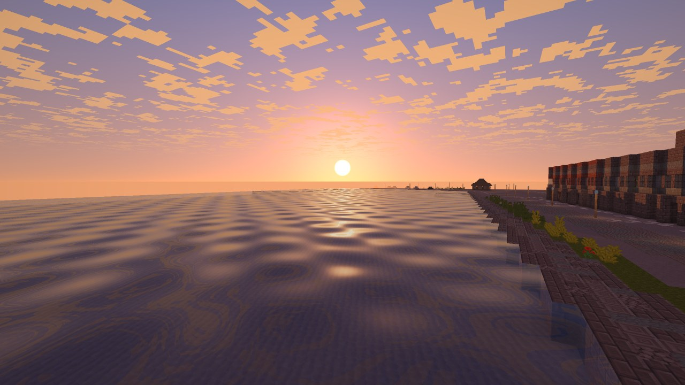
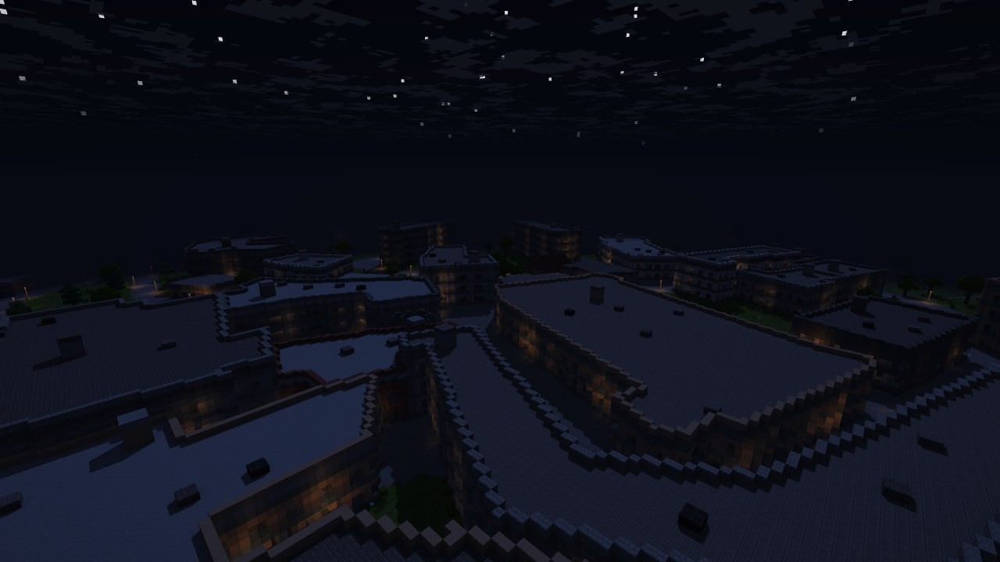
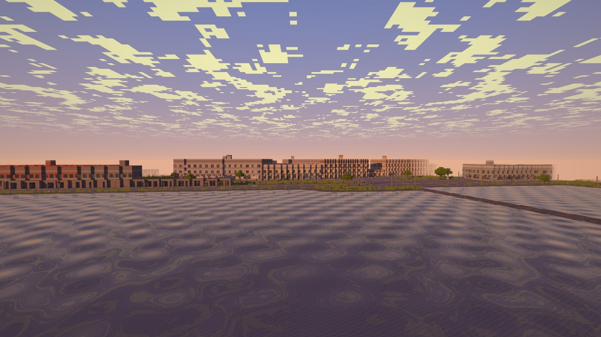
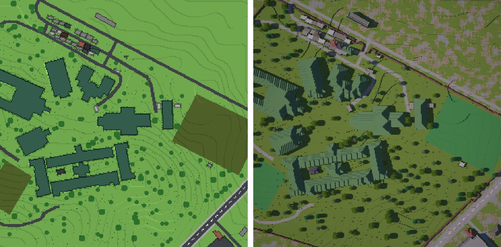
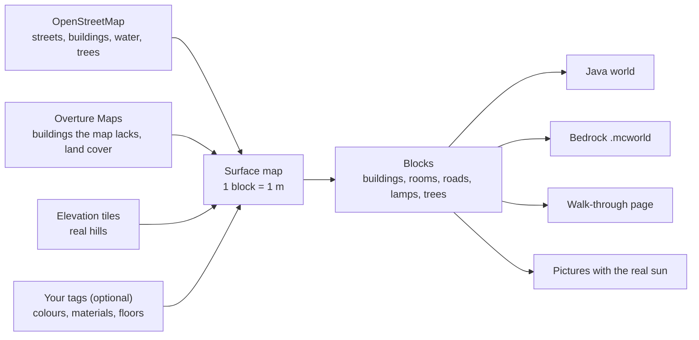

<h1 align="center">place2mc</h1>

<p align="center">
  <b>Turn any real place on Earth into Minecraft.</b><br>
  Pick a spot on a map, press Convert, and walk around it: in Minecraft Java, in Bedrock, or right in your browser.
</p>

<p align="center">
  
  
  
  
  
</p>

<p align="center">
  
  <br><sub>A day at African Leadership Academy in Johannesburg, 06:00 to 21:00. The sun moves the way it really does over
  the school in November; shadows, sunset and the lit-up windows at night come from place2mc's own renderer.</sub>
</p>

<p align="center">
  <a href="https://raw.githack.com/AstroAli5/place2mc/main/examples/ala/Walk%20around%20ALA.html"><b>▶ Walk around ALA in your browser</b></a> (no install, no Minecraft)
  &nbsp;·&nbsp; <a href="#use-it"><b>Make your own place</b></a>
  &nbsp;·&nbsp; <a href="#how-it-works"><b>How it works</b></a>
</p>

## Walk around it

Every conversion also makes a page you open in any browser, on a computer or a phone. Walk with W A S D and the
mouse, jump, sprint, fly (F), go 2, 4 or 8 times faster (1-4), change the time of day (T) and switch the shaders (G).

<p align="center"></p>

## The real sun

The sun stands where it really does over that place on the day you look at it: east in the morning, north at noon
south of the tropics, low in the south in a London winter. Buildings and trees cast shadows, water mirrors the sky,
and after dark the street lamps and the rooms behind the windows light up.



| | |
|---|---|
|  |  |
|  |  |
|  |  |

## How it works

Everything sits where it is in the real place, at real size: 1 block is 1 metre.





What gets built, besides streets, buildings and hills:

- **Buildings** at their mapped height and in their mapped colours and materials (brick, plaster, concrete, wood,
  green or red metal roofs), with windows, doors, floors, sloped roofs with eaves or flat roofs with rooftop units
- **Rooms** behind the windows: inner walls with doorways, bookshelves, desks, chairs and hanging lanterns on every floor
- **Streets** at their real width, with sidewalks, centre lines, zebra crossings, traffic lights, street lamps and
  half slabs where a street climbs
- **Car parks** with bay lines and parked cars; shelters and covered walkways on pillars
- **Fences, garden walls, face-brick walls and hedges**, railway and tram tracks, benches
- **Nature**: parks, forests, lawns, street trees and mapped trees, bushes and flowers by the walls, rivers, lakes
  and the sea

## Use it

1. Install Python 3 from [python.org](https://www.python.org/downloads/) (on Windows, tick "Add python.exe to PATH").
2. Download this repository (green **Code** button, **Download ZIP**) and unzip it.
3. Double-click **start-windows.bat** (Windows) or **start-mac.command** (Mac). A page opens in your browser.
4. Search for a place or click on the map, choose the size and the edition, and press **Convert**.
5. When it says Done:
   - **Walk around**: press **Walk around** and walk with W A S D and the mouse, right in the browser. Keys 1 to 4
     set the speed (normal, ×2, ×4, ×8), F flies, T changes the time of day (morning, midday, afternoon, sunset,
     night) and G switches the shaders (sunlight with shadows, sunlight only, or plain Minecraft). The sun stands
     where it really does over that place on the day you open it, and at night the lanterns light the streets and rooms. The file `Walk around <name>.html` in the world folder does the
     same on any computer or phone: just open it.
   - **Java**: open Minecraft, go to Singleplayer, and the new world is in the list. You start on a street in the middle.
   - **Bedrock**: press **Add to Bedrock** (on Windows, Minecraft opens and imports the world), or send the
     `.mcworld` file to your phone or tablet and open it there.

New worlds are Creative, Peaceful, always noon, with no mobs, and empty around the built square.

| Edition | Works with |
|---|---|
| Java | 1.21.4 or newer for new worlds; 1.18 to 1.21.3 with `--world` (build into a Superflat world you made) |
| Bedrock | 1.21.120 or newer on Windows, Android, iPhone and iPad (anything that opens a `.mcworld` file) |

## Command line

```
pip install numpy pillow
python place2mc.py "Needham, Massachusetts"                       # new Java world
python place2mc.py "Needham, Massachusetts" --edition both --screenshots
python place2mc.py --center 51.5007,-0.1246 --radius 500 --edition bedrock
```

To make a place look more like itself, give it the colours and materials the map doesn't have yet:
`--tags file.json` adds building colours, wall and roof materials, roof shapes and floors (see
`examples/ala/ala-tags.json`, made from African Leadership Academy's campus photos). Tags already on
OpenStreetMap (`building:colour`, `building:material`, `roof:colour`, `roof:material`, `roof:shape`,
`building:levels`) are used automatically.

Pictures: `--screenshots` draws the result in the afternoon sun with shadows, plus the rooftops at sunset and a
street at night. `--picture-time morning|midday|afternoon|sunset|night` picks the time, `--plain-pictures` the
game's plain noon light (faster).

Other options: `--osm-file map.osm` (work offline from a saved map), `--flat` (no hills), `--preview-only`,
`--textures PATH` (a game .jar or resource pack for the pictures). `python place2mc.py --help` lists them all.

## Example

[`examples/ala`](examples/ala): African Leadership Academy in Johannesburg. [Walk around it in your browser](https://raw.githack.com/AstroAli5/place2mc/main/examples/ala/Walk%20around%20ALA.html),
or download `Walk around ALA.html` and open it. Its tag file shows how to make a place look more like itself
(the school's red face-brick walls and dark green metal roofs, from campus photos and Street View).

## Where the map is thin

OpenStreetMap is detailed in many cities but thin in many places (African Leadership Academy has 11 of its
buildings on it). So place2mc also reads **Overture Maps**, a free worldwide map that adds buildings found in
aerial imagery (Microsoft, Google) and Esri's community maps, with heights, floors and roof details where known,
and **ESA WorldCover** land cover (forest, shrubs, crops, bare ground) seen from space. It only adds what
OpenStreetMap does not have, and never replaces it. Turn it off with `--no-overture`.

## How it was checked, and what was not

The worlds were read back block by block with independent readers: nbtlib and anvil-parser2 for Java,
and for Bedrock a separate Python reader plus rusty-leveldb (the database library Arnis uses). Every block
name and state was checked against the game's own block lists from PrismarineJS/minecraft-data for Java 1.18,
1.21.4 and Bedrock 1.21.120. The app was tested end to end in a browser.

Not checked yet: opening the worlds in the real game (the computer this was built on has no Minecraft),
live map and elevation downloads (it had no access to those servers; tests used saved map files and test
elevation tiles), and the game's own textures for the pictures.

## Credits

- Map data © [OpenStreetMap](https://www.openstreetmap.org/copyright) contributors (ODbL). Worlds built from
  it contain OpenStreetMap data, so credit it if you share them.
- Buildings the map lacks: [Overture Maps Foundation](https://overturemaps.org) (ODbL); land cover from
  [ESA WorldCover](https://esa-worldcover.org) (CC BY 4.0), through Overture's base theme. The way to read them
  (PMTiles over HTTP) follows Arnis.
- Elevation: Terrain Tiles on AWS (Mapzen / Tilezen), from SRTM, USGS and other public sources.
- Textures for the pictures and the walk-through when Minecraft is not installed: [Pixel Perfection CE](https://github.com/Athemis/PixelPerfectionCE)
  by XSSheep and contributors, CC BY-SA 4.0 (see `textures/pixel-perfection-ce/CREDITS.md`).
- Map in the app: [Leaflet](https://leafletjs.com) (BSD-2-Clause, licence in `app/leaflet/LICENSE`).
- [Arnis](https://github.com/louis-e/arnis) (Apache-2.0) does the same job in more detail; its Bedrock worlds
  were the reference for the Bedrock file layout and settings used here.
- Block lists for the tests: [PrismarineJS/minecraft-data](https://github.com/PrismarineJS/minecraft-data).
- No Minecraft files are included or copied. Not an official Minecraft product; not approved by or associated
  with Mojang or Microsoft.
