<h1 align="center">place2mc</h1>

<p align="center">
  <b>Turn any real place on Earth into Minecraft.</b><br>
  Pick a spot on a map, press Convert, then walk around it, build in it and play it:
  in Minecraft Java, in Bedrock, or right in your browser.
</p>

<p align="center">
  
  
  
  
  
  
  
</p>

<p align="center">
  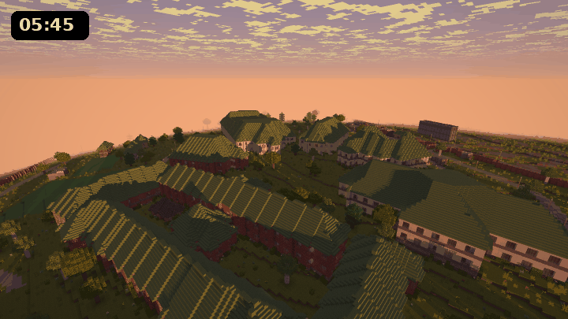
  <br><sub>A day at African Leadership Academy in Johannesburg, 06:00 to 21:00. The sun moves the way it really does over
  the school in November; shadows, sunset and the lit-up windows at night come from place2mc's own renderer.</sub>
</p>

<p align="center">
  <a href="https://raw.githack.com/AstroAli5/place2mc/main/examples/ala/Walk%20around%20ALA.html"><b>▶ Walk around ALA in your browser</b></a> (no install, no Minecraft)
  &nbsp;·&nbsp; <a href="#use-it"><b>Make your own place</b></a>
  &nbsp;·&nbsp; <a href="#controls"><b>Controls</b></a>
  &nbsp;·&nbsp; <a href="#how-it-works"><b>How it works</b></a>
  &nbsp;·&nbsp; <a href="#whats-new"><b>What's new</b></a>
</p>

<table>
<tr>
<td width="33%">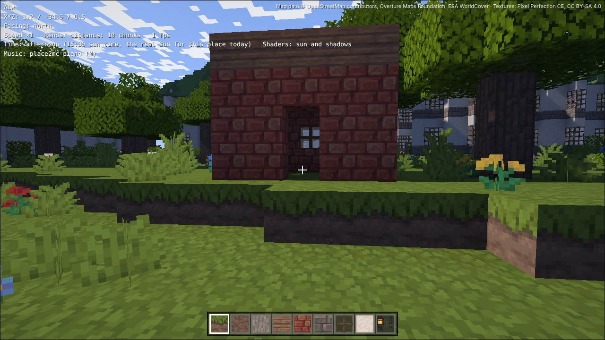<br><b>Build in it.</b> Creative mode in the browser: break, place, pick.</td>
<td width="33%">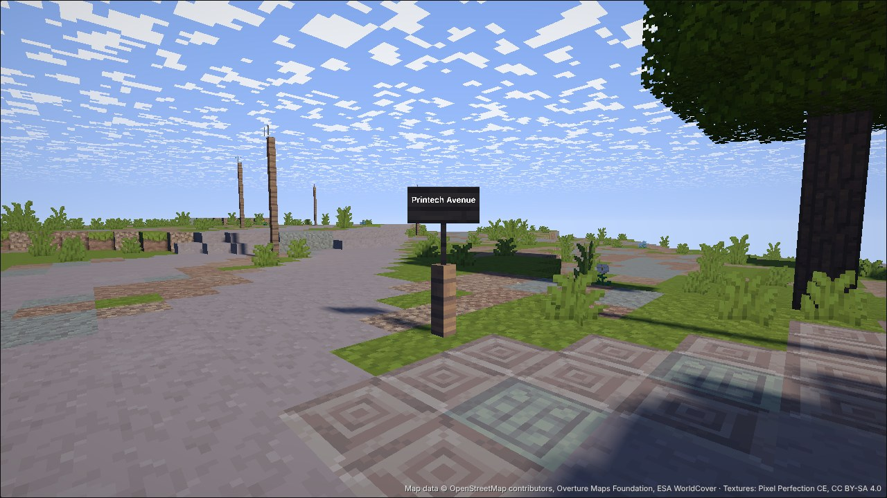<br><b>Real street names</b> on signs at every crossing, in Java and Bedrock too.</td>
<td width="33%">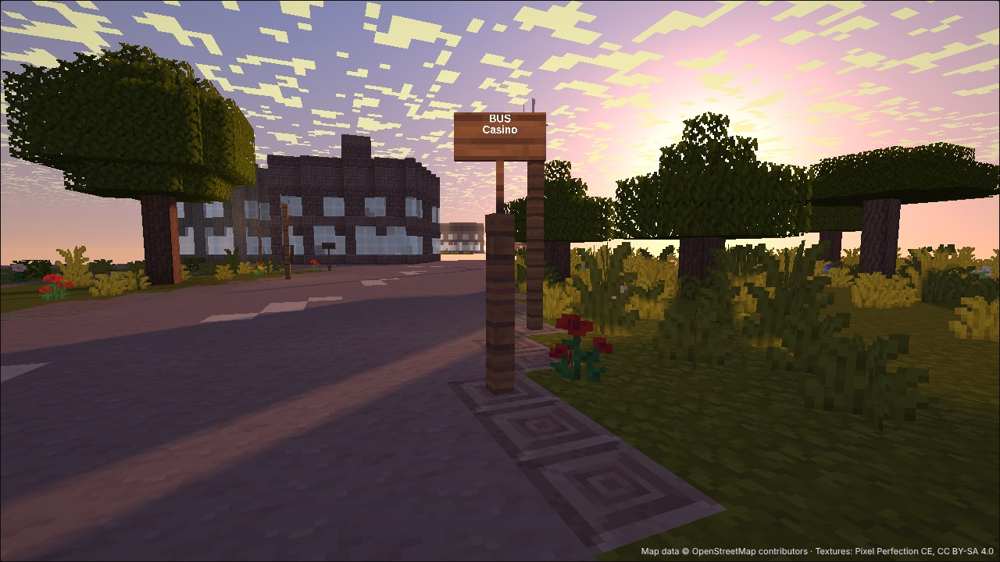<br><b>Road signs and bus stops</b> where the map has them.</td>
</tr>
<tr>
<td><br><b>The real sun</b> for that place and day; lamps and windows light up at night.</td>
<td>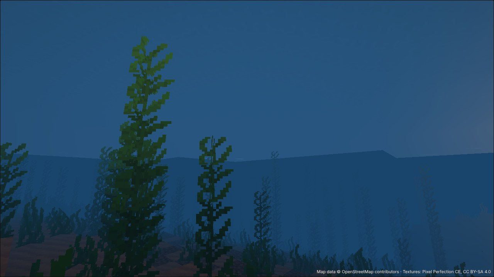<br><b>Seas at their real depth</b>, with seagrass and kelp. Swim down.</td>
<td>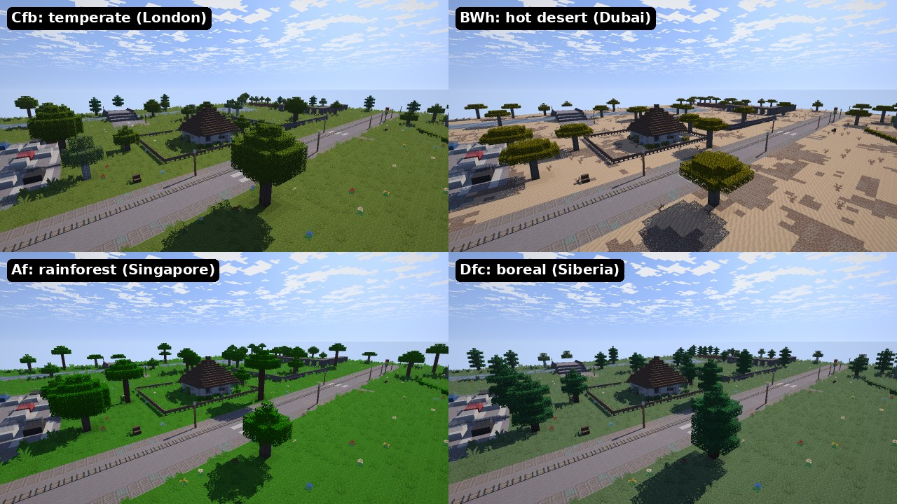<br><b>Any climate on Earth</b>: the grass, trees and ground of that place.</td>
</tr>
</table>

## What's inside

**The world** (Java and Bedrock): streets at their real width with sidewalks, centre lines, zebra crossings and
traffic lights; buildings at their mapped height, colours and materials, with windows, doors, roofs and furnished
rooms on every floor; the real hills and the sea at its real depth; bridges at the right height and tunnels left
out; street names, stop and give-way signs, bus stops and shelters, hydrants, bins and lamps from the map; car parks
with cars; fences, walls, hedges, railways and tram lines; parks, forests and trees of the local climate; seagrass and
kelp under water.

**The walk-through** (any browser, computer or phone): moves exactly like the game (measured), creative mode to
break and place blocks, the real sun with shadows, day and night and "now", water with reflections, swimming,
smooth lighting, readable street signs, touch controls on phones.

**Sound and music**: footsteps for each kind of ground, birds, crickets, waves, wind, original piano music, your own
songs from a file or from Spotify.

**The map behind it**: OpenStreetMap, plus Overture Maps for buildings the map lacks, ESA WorldCover land cover,
elevation tiles for hills and sea depth, and a world climate map.

## Walk around it

Every conversion also makes a page you open in any browser, on a computer or a phone, with no Minecraft needed.

<p align="center">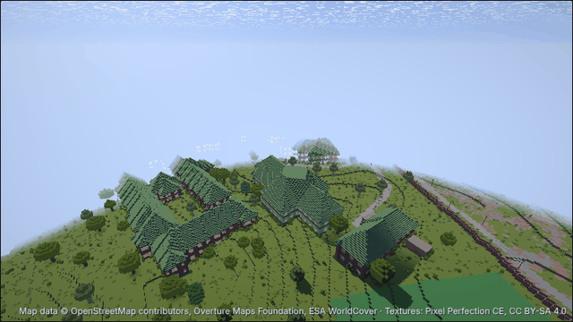</p>

### Controls

| Keyboard and mouse | | Phone and tablet | |
|---|---|---|---|
| W A S D, mouse | walk, look around | left stick, drag | walk, look around |
| Space | jump (twice: fly) | ▲ / ▼ | jump or fly up / go down |
| Ctrl or W W | sprint | fly | fly on / off |
| Shift | sneak (flying: go down) | ×1 | speed ×1, ×2, ×4, ×8 |
| F | fly on / off | ⛏ / ▣ | break / place the block in the middle |
| Left / right / middle click | break / place / pick a block | ♪ | music on / off |
| 1 … 9, mouse wheel | choose a block in the hotbar | | |
| - and = | speed: normal, ×2, ×4, ×8 | | |
| T | time: morning, midday, afternoon, sunset, night, now | | |
| G | shaders: sun and shadows, sun only, plain Minecraft | | |
| M / N | music on / off / play your own music file | | |
| V / J | view bobbing / auto-jump on or off | | |
| [ and ] | see less / farther | | |
| R / Esc | back to the start / pause | | |

### Moves exactly like the game

The walk-through runs the game's movement rules 20 times a second, as Minecraft does: the same push from the keys,
the same friction on the ground and in the air, the same gravity, jump and flying. `tests/walk_physics.py` measures
it against the numbers on the Minecraft Wiki:

| | Walk-through | Minecraft |
|---|---|---|
| Walking | 4.317 blocks a second | 4.317 |
| Sprinting | 5.612 | 5.612 |
| Sneaking | 1.295 | 1.295 |
| Flying | 10.88 | 10.89 |
| Sprint-flying | 21.77 | 21.78 |
| Sprint-jumping (average) | 7.126 | 7.127 |
| Jump height | 1.2522 blocks | 1.2522 |
| Jump, ground to ground | 12 ticks | 12 |

The camera bobs as you walk (V turns it off), widens a little when you sprint or fly, and drops when you sneak.
Auto-jump hops onto one-block steps, like the game's option (J).

### Build in it

Creative mode, right in the browser. The block you aim at gets a thin outline (up to 5 blocks away, the game's
reach). Left click breaks it, right click places the block from your hotbar against the face you look at (never
inside yourself), middle click picks the block you look at. Choose blocks with 1 to 9 or the mouse wheel. What you
build stays in your browser for that world, and **Undo my building** on the pause screen takes it all away.

<p align="center">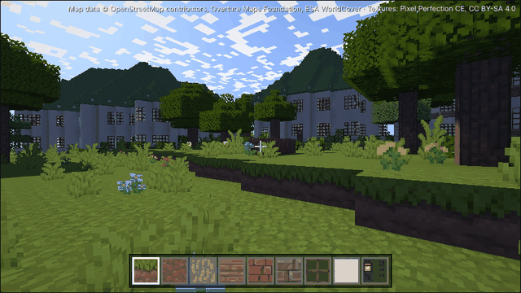</p>

### Sound and music

Everything is made in the page itself (the Web Audio API), no sound files: footsteps that sound like what you walk
on (grass, stone, wood, sand, gravel, snow, water), a thud when you land, birds in the day, crickets at night, waves
that get louder near the sea, wind when you fly high, everything muffled with your head under water. A calm piano
plays in the background: place2mc's own music, made up fresh as you walk, with long quiet gaps like the game's.

<p align="center">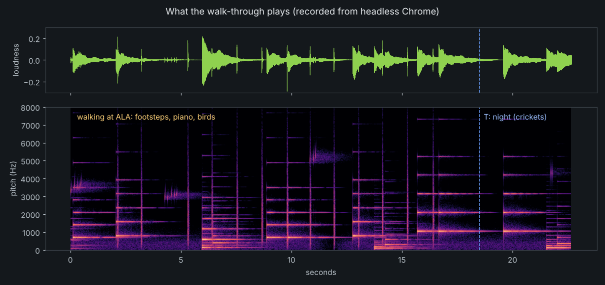</p>
<p align="center"><sub>22 seconds of walking at ALA, recorded from the page: footsteps (short vertical lines), piano notes
(the stacked lines), birds (high chirps), then T for night and the crickets. <a href="docs/walk-sound-ala.m4a">Listen</a>.</sub></p>

### Your own music, or Spotify

- **A song file**: press **Play your own music** (or N) and choose a song on your computer or phone. It plays from
  your device and is never uploaded anywhere.
- **Spotify**: press the green **Spotify** button, paste a Spotify link (in Spotify: Share, then Copy link; a song,
  an album or a playlist) and press **Load**. Spotify's own player appears; press play in it, then walk. Esc
  brings it back to pause or change the song, and the piano stops while it is loaded. The link is remembered for
  next time. Logged in to Spotify in the same browser you hear whole songs; otherwise Spotify plays 30-second
  previews (and on phones it often only plays previews).
- **M** turns the piano or your song file on and off.

### The real sun, now

The sun stands where it really does over that place on the day you look at it: east in the morning, north at noon
south of the tropics, low in the south in a London winter. Press T until it says **now** and the sun is where it is
over the place this very minute. Buildings and trees cast shadows, water mirrors the sky, and after dark the street
lamps and the rooms behind the windows light up.


| | |
|---|---|
|  |  |
| 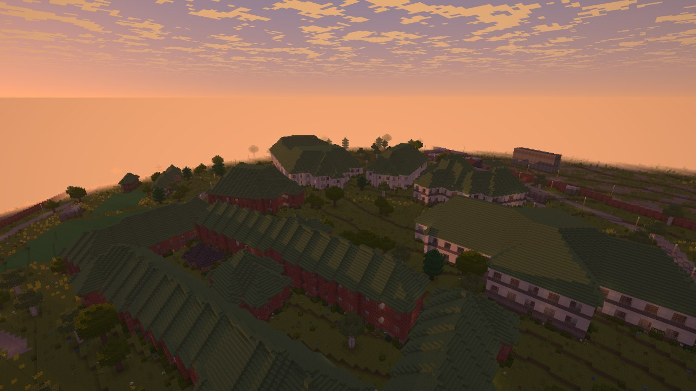 | 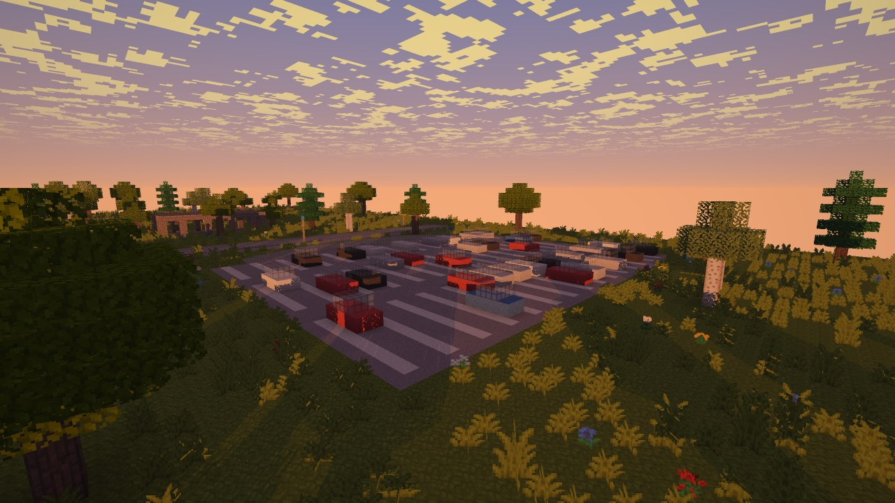 |

## Real details from the map

**Street names.** Every crossing gets a sign for each named street there, with the real name, on a post beside the
street and turned to face the crossing. The names are in the Java and the Bedrock world (Bedrock shows them on both
sides) and you can read them in the walk-through.

**Road signs and street furniture.** STOP and GIVE WAY signs (YIELD in North America) stand beside the road, facing
the drivers who must stop, on their side of the road: the left in the UK, South Africa, India, Japan, Australia and
the other left-hand-traffic countries. Bus stops get a pole with their name and, where the map says so, a glass
shelter with a bench. Fire hydrants, litter bins and street lamps stand where the real ones are.

| | | |
|---|---|---|
| 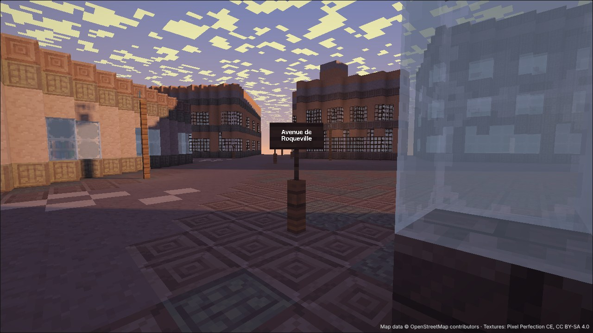 | 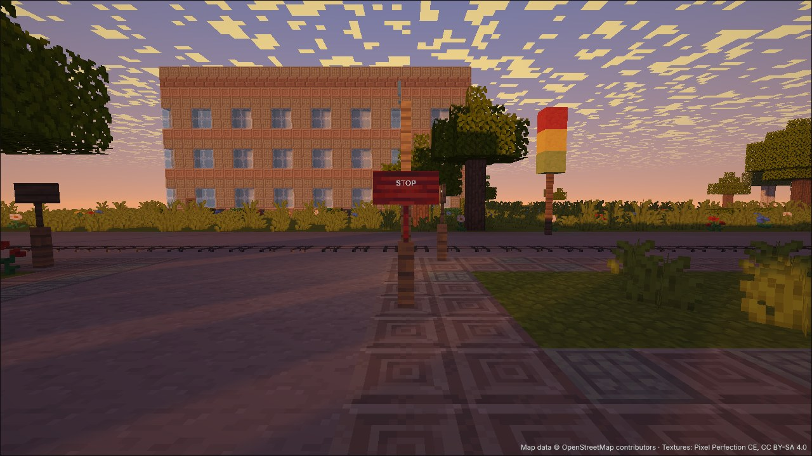 | 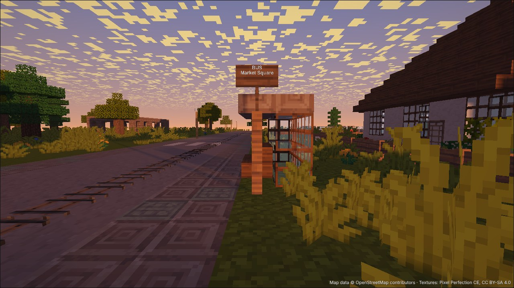 |

**Everything else that gets built:**

- **Buildings** at their mapped height and in their mapped colours and materials (brick, plaster, concrete, wood,
  green or red metal roofs), with windows, doors, floors, sloped roofs with eaves or flat roofs with rooftop units
- **Rooms** behind the windows: inner walls with doorways, bookshelves, desks, chairs and hanging lanterns on every floor
- **Streets** at their real width, with sidewalks, centre lines, zebra crossings, traffic lights, street lamps and
  half slabs where a street climbs
- **Car parks** with bay lines and parked cars; shelters and covered walkways on pillars
- **Fences, garden walls, face-brick walls and hedges**, railway and tram tracks, benches
- **Bridges** at the right height over rivers, roads and railways, with ramps, walls and pillars; tunnels left out
- **Nature** in the place's own climate: parks, forests, lawns, street trees and mapped trees (oak, birch, spruce,
  acacia, jungle), bushes and flowers by the walls, dead bushes in dry places
- **Water**: rivers and lakes that get deeper away from their banks, the sea at its real depth, seagrass meadows,
  and kelp forests in cool seas

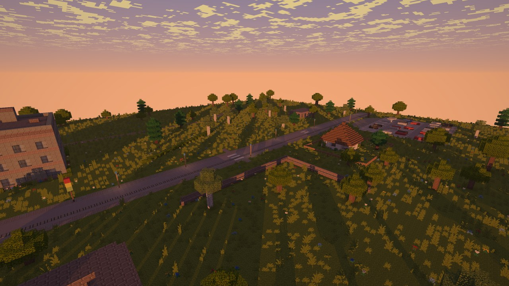

## Real heights from laser scans (anywhere in the US)

In the US, place2mc can use the government's laser scans of the land (USGS 3DEP LiDAR, public domain): an aircraft
measured the ground, every roof and every tree to a few centimetres. Every 1 m of every roof then sits at its measured
height, with its slopes, gables, towers, cupolas and chimneys; every tree stands where it really is, as tall and as wide
as it really is; buildings the map is missing are added from the scan; and the ground is the scan's bare earth.

1. Make a page for your place: `python tools/make_fetch_page.py LAT LON SIZE EPT_URL "Get my data.html"` (the scan's
   address is in [the USGS scans list](https://github.com/hobuinc/usgs-lidar)), open it in a browser and press Start.
   It saves `place2mc-data.json`: the map and the scan, boiled down (about 1.5 MB for 1.5 km x 1.5 km).
2. `python place2mc.py --osm-file place2mc-data.json --lidar place2mc-data.json --center LAT,LON --radius SIZE/2`

Example: [Franklin & Marshall College](examples/fandm), Lancaster, Pennsylvania, from the 2019 scan (11.4 million laser
points). On the 86 named buildings, 93.5% of the roof is within 1 m of the scan; Old Main's tower comes out 36 blocks
tall (the scan says 36.0 m, the college archives 121 ft, 36.9 m).

## Any place on Earth

Every place gets the climate it really has, from a world climate map: the biome, the colour of the grass and the
leaves, sand or dry earth where nothing is mapped, and the trees that grow there.


| | |
|---|---|
| 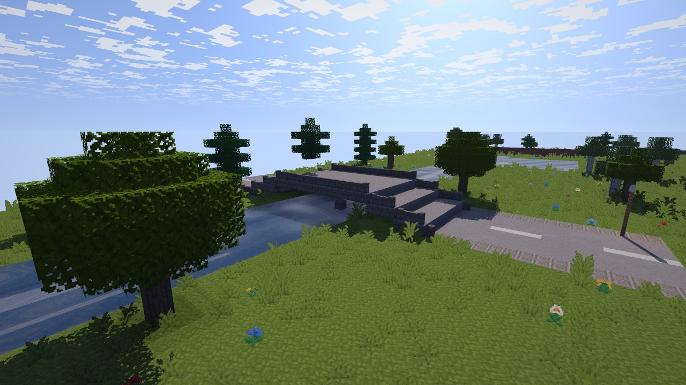 | 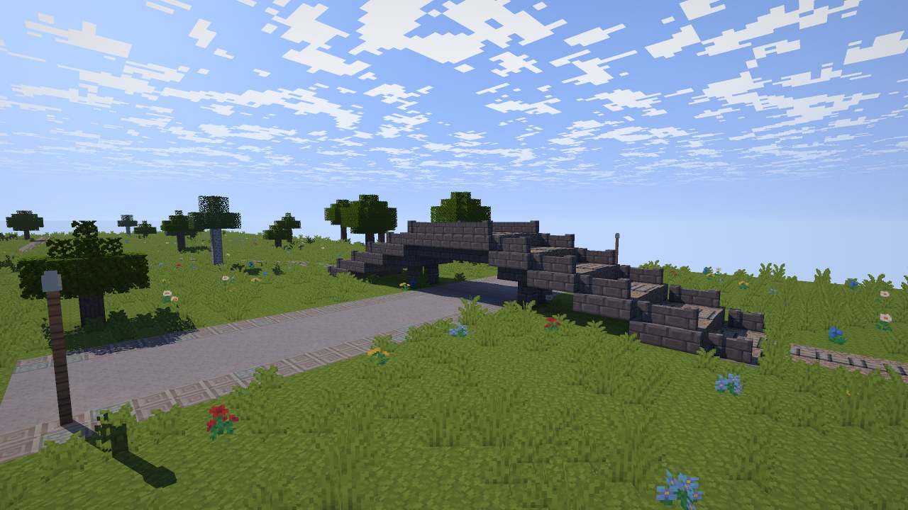 |
| 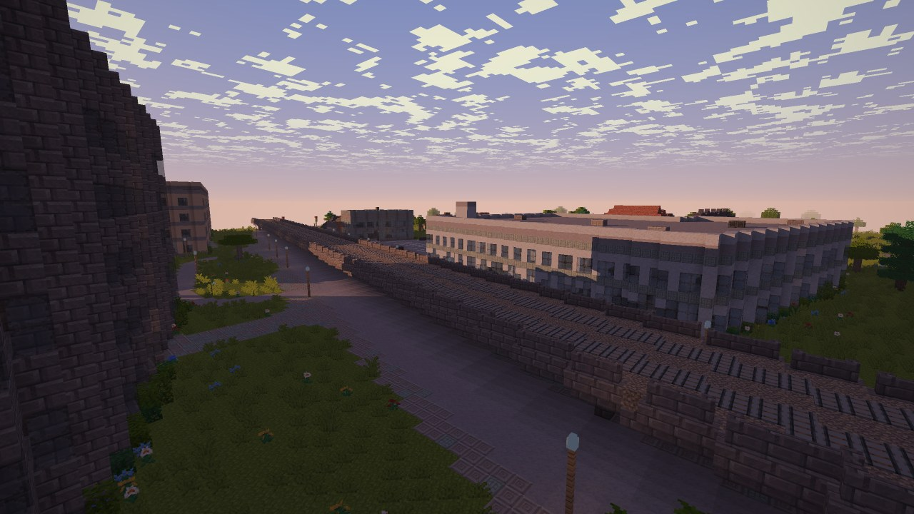 | 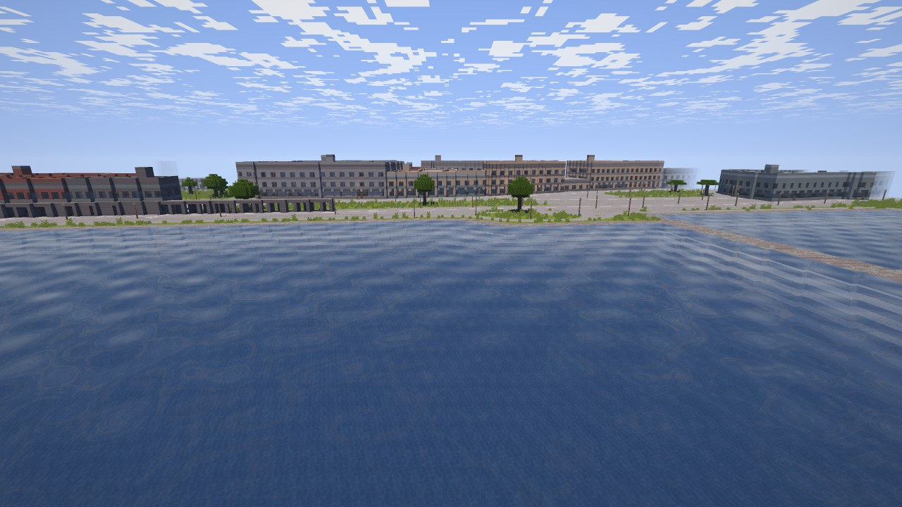 |
|  | 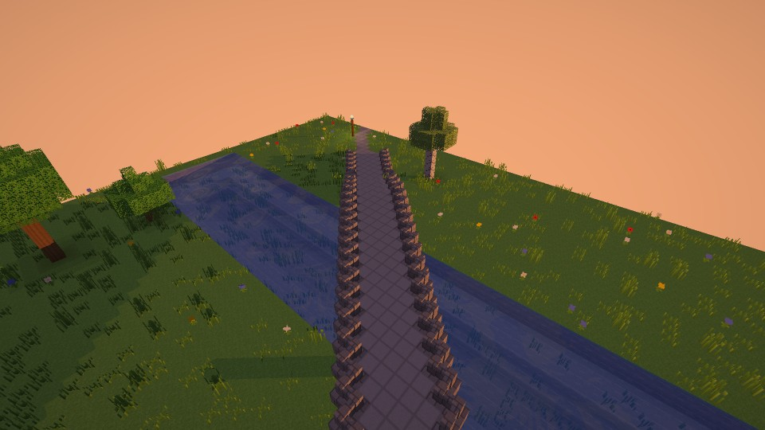 |

## How it works

Everything sits where it is in the real place, at real size: 1 block is 1 metre.


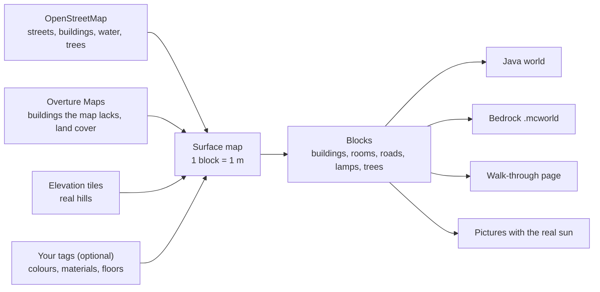

What gets built, besides streets, buildings and hills:

- **Buildings** at their mapped height and in their mapped colours and materials (brick, plaster, concrete, wood,
  green or red metal roofs), with windows, doors, floors, sloped roofs with eaves or flat roofs with rooftop units
- **Rooms** behind the windows: inner walls with doorways, bookshelves, desks, chairs and hanging lanterns on every floor
- **Streets** at their real width, with sidewalks, centre lines, zebra crossings, traffic lights, street lamps and
  half slabs where a street climbs
- **Car parks** with bay lines and parked cars; shelters and covered walkways on pillars
- **Fences, garden walls, face-brick walls and hedges**, railway and tram tracks, benches
- **Bridges** at the right height over rivers, roads and railways, with ramps, walls and pillars; tunnels left out
- **Nature** in the place's own climate: parks, forests, lawns, street trees and mapped trees (oak, birch, spruce,
  acacia, jungle), bushes and flowers by the walls, dead bushes in dry places, rivers, lakes and the sea at its depth

## Use it

1. Install Python 3 from [python.org](https://www.python.org/downloads/) (on Windows, tick "Add python.exe to PATH").
2. Download this repository (green **Code** button, **Download ZIP**) and unzip it.
3. Double-click **start-windows.bat** (Windows) or **start-mac.command** (Mac). A page opens in your browser.
4. Search for a place or click on the map, choose the size and the edition, and press **Convert**.
5. When it says Done:
   - **Walk around**: press **Walk around** to walk, fly and build right in the browser (see [Controls](#controls)).
     The file `Walk around <name>.html` in the world folder does the same on any computer or phone: just open it.
   - **Java**: open Minecraft, go to Singleplayer, and the new world is in the list. You start on a street in the middle.
   - **Bedrock**: press **Add to Bedrock** (on Windows, Minecraft opens and imports the world), or send the
     `.mcworld` file to your phone or tablet and open it there.

New worlds are Creative, Peaceful, always noon, with no mobs, and empty around the built square.

| Edition | Works with |
|---|---|
| Java | 1.21.4 or newer for new worlds; 1.18 to 1.21.3 with `--world` (build into a Superflat world you made) |
| Bedrock | 1.21.120 or newer on Windows, Android, iPhone and iPad (anything that opens a `.mcworld` file) |

## Command line

```
pip install numpy pillow
python place2mc.py "Needham, Massachusetts"                       # new Java world
python place2mc.py "Needham, Massachusetts" --edition both --screenshots
python place2mc.py --center 51.5007,-0.1246 --radius 500 --edition bedrock
```

To make a place look more like itself, give it the colours and materials the map doesn't have yet:
`--tags file.json` adds building colours, wall and roof materials, roof shapes and floors (see
`examples/ala/ala-tags.json`, made from African Leadership Academy's campus photos). Tags already on
OpenStreetMap (`building:colour`, `building:material`, `roof:colour`, `roof:material`, `roof:shape`,
`building:levels`) are used automatically.

Pictures: `--screenshots` draws the result in the afternoon sun with shadows, plus the rooftops at sunset and a
street at night. `--picture-time morning|midday|afternoon|sunset|night` picks the time, `--plain-pictures` the
game's plain noon light (faster).

Other options: `--osm-file map.osm` (work offline from a saved map), `--flat` (no hills), `--preview-only`,
`--textures PATH` (a game .jar or resource pack for the pictures). `python place2mc.py --help` lists them all.

## Example

[`examples/ala`](examples/ala): African Leadership Academy in Johannesburg, one example among any place you choose.
[Walk around it in your browser](https://raw.githack.com/AstroAli5/place2mc/main/examples/ala/Walk%20around%20ALA.html),
or download `Walk around ALA.html` and open it. Its tag file shows how to make a place look more like itself
(the school's red face-brick walls and dark green metal roofs, from campus photos and Street View).

## What's new

| Version | |
|---|---|
| **1.8** | Real heights from laser scans in the US: every roof, tower and tree as measured; Franklin & Marshall College as the example |
| **1.7** | The walk-through moves exactly like the game (8 measurements, all match); creative mode to break and place blocks, with a hotbar, kept in your browser; a map of the code made with [graphify](https://github.com/Graphify-Labs/graphify) |
| **1.6** | Spotify in the walk-through; stop and give-way signs on the right side of the road for each country, bus stops with shelters, fire hydrants, bins, street lamps where the real ones are |
| **1.5** | Street-name signs with the real names (Java, Bedrock, walk-through); "now": the real sun this minute |
| **1.4** | Footsteps, birds, crickets, waves, wind, original piano music, your own songs; seagrass and kelp; swimming |
| **1.3** | The real climate everywhere; the sea at its real depth; bridges and tunnels |
| **1.2** | This page: the time-lapse, the fly-over and a live walk-through |
| **1.1** | The real sun and shadows in the pictures too |
| **1.0** | Sun, shadows, lamps at night and water reflections in the walk-through; rooms behind the windows; brick walls |
| **0.9** | Faster walking, furnished rooms, car parks, traffic lights, covered walkways, building heights from floors |
| **0.8** | Overture buildings and ESA land cover where OpenStreetMap is thin |
| **0.7** | Building colours and materials, and tag files to add what the map lacks |
| **0.6** | The walk-through and the Minecraft-style textures |

## Where the map is thin

OpenStreetMap is detailed in many cities but thin in many places (African Leadership Academy has 11 of its
buildings on it). So place2mc also reads **Overture Maps**, a free worldwide map that adds buildings found in
aerial imagery (Microsoft, Google) and Esri's community maps, with heights, floors and roof details where known,
and **ESA WorldCover** land cover (forest, shrubs, crops, bare ground) seen from space. It only adds what
OpenStreetMap does not have, and never replaces it. Turn it off with `--no-overture`.

## Roadmap

[docs/ROADMAP.md](docs/ROADMAP.md): what was wrong and has been fixed, what research found about making this work
for any place in the world, and what comes next. [docs/code-map.md](docs/code-map.md): how the code fits together,
mapped with graphify.

## How it was checked, and what was not

The worlds were read back block by block with independent readers: nbtlib and anvil-parser2 for Java,
and for Bedrock a separate Python reader plus rusty-leveldb (the database library Arnis uses). Every block
name and state was checked against the game's own block lists from PrismarineJS/minecraft-data for Java 1.18,
1.21.4 and Bedrock 1.21.120, and every sign's text and colour was read back from both editions. A made-up test
town checks the details one by one (crossings, walls, rails, bridges, the tunnel, the lake, street names, road signs,
the bus shelter, hydrants, bins, lamps). In a browser, tests measure the movement against the game, count the
footsteps, notes and bird calls, try the building and the Spotify box, and run the whole app from map to world.

Not checked yet: opening the worlds in the real game (the computer this was built on has no Minecraft),
live map and elevation downloads (it had no access to those servers; tests used saved map files and test
elevation tiles), the game's own textures for the pictures, Spotify actually playing, and how the walk-through
feels on a real phone or with a real mouse.

## Credits

- Map data © [OpenStreetMap](https://www.openstreetmap.org/copyright) contributors (ODbL). Worlds built from
  it contain OpenStreetMap data, so credit it if you share them.
- Buildings the map lacks: [Overture Maps Foundation](https://overturemaps.org) (ODbL); land cover from
  [ESA WorldCover](https://esa-worldcover.org) (CC BY 4.0), through Overture's base theme. The way to read them
  (PMTiles over HTTP) follows Arnis.
- Elevation: Terrain Tiles on AWS (Mapzen / Tilezen), from SRTM, USGS, NOAA ETOPO1 (sea depths) and other
  public sources.
- Climate: the Köppen-Geiger map of Rubel, Brugger, Haslinger and Auer (2016), as shipped in
  [kgcpy](https://github.com/cwru-sdle/kgcpy) (BSD-3), reduced to 0.25 degrees in `data/koppen.png`.
- Bridges follow the idea of [OSM2World](https://osm2world.org): heights worked out from the map and the terrain.
- Textures for the pictures and the walk-through when Minecraft is not installed: [Pixel Perfection CE](https://github.com/Athemis/PixelPerfectionCE)
  by XSSheep and contributors, CC BY-SA 4.0 (see `textures/pixel-perfection-ce/CREDITS.md`).
- Map in the app: [Leaflet](https://leafletjs.com) (BSD-2-Clause, licence in `app/leaflet/LICENSE`).
- [Arnis](https://github.com/louis-e/arnis) (Apache-2.0) does the same job in more detail; its Bedrock worlds
  were the reference for the Bedrock file layout and settings used here.
- Block lists for the tests: [PrismarineJS/minecraft-data](https://github.com/PrismarineJS/minecraft-data).
- The game's movement numbers: the Minecraft Wiki (Player, Transportation); Bedrock's sign format: PocketMine-MP.
- Code map: [graphify](https://github.com/Graphify-Labs/graphify) (Apache-2.0).
- No Minecraft files are included or copied. Not an official Minecraft product; not approved by or associated
  with Mojang or Microsoft.
