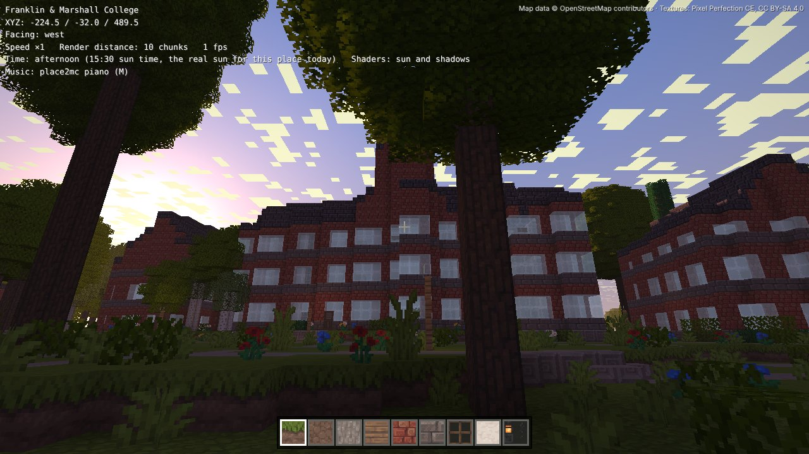

# Franklin & Marshall College

Franklin & Marshall College in Lancaster, Pennsylvania, built at 1 block = 1 metre from OpenStreetMap and the US
government's 2019 laser scan of the land (USGS 3DEP LiDAR): every roof at its measured height, metre by metre, with its
towers, cupolas, gables and chimneys; every tree where it stands, as tall and as wide as it is; the ground as scanned.
1.5 km x 1.5 km around the campus, Java and Bedrock.

**[Walk around it in your browser](https://raw.githack.com/AstroAli5/place2mc/main/examples/fandm/Walk%20around%20Franklin%20%26%20Marshall%20College.html)**
(about 4 MB; you start on the lawn in front of Old Main, looking at its tower).

## How it was made

1. `Get F&M data.html` (made by `tools/make_fetch_page.py`) ran in a browser: OpenStreetMap's map, and 11.4 million laser
   points of the 2019 scan `PA_Northcentral_B1_2019`, boiled down to `place2mc-data.json`.
2. `python place2mc.py --osm-file place2mc-data.json --lidar place2mc-data.json --center 40.04966,-76.31705 --radius 768
   --tags examples/fandm/fandm-tags.json --spawn 40.045252,-76.319681,270 --edition both`

## How exact it is

Heights, compared on every 1 m of roof of the 86 named buildings: 93.5% within 1 m of the laser scan (0.6 m on average;
Minecraft rounds to whole blocks). Old Main's tower: 36 blocks; the scan measures 36.0 m and the college archives give
121 ft (36.9 m). The Java world reads back with two libraries, and the Bedrock world block for block (78 million blocks,
0 wrong).

| Building | Laser scan 2019: roof middle / top 5% / highest (m) | In the world, blocks above the ground | Roof within 1 m of the scan |
|---|---|---|---|
| Old Main | 15.5 / 18.5 / 36.0 | 16 / 18 / 36 | 94% |
| Goethean Hall | 13.5 / 16.0 / 17.0 | 14 / 16 / 16 | 98% |
| Diagnothian Hall | 14.0 / 16.5 / 16.5 | 14 / 16 / 16 | 96% |
| Hensel Hall | 12.0 / 17.0 / 28.0 | 12 / 16 / 28 | 96% |
| Keiper Hall | 14.5 / 21.0 / 29.5 | 14 / 21 / 29 | 86% |
| Shadek-Fackethal Library | 13.0 / 16.5 / 26.5 | 13 / 16 / 20 | 94% |
| Steinman College Center | 9.5 / 10.5 / 12.5 | 10 / 10 / 12 | 97% |
| Stager Hall | 16.5 / 20.5 / 23.0 | 16 / 20 / 22 | 93% |
| Harris Center for Government | 14.5 / 17.0 / 21.5 | 14 / 17 / 19 | 89% |
| Hackman Physical Sciences Laboratory | 16.0 / 17.5 / 22.0 | 16 / 18 / 22 | 96% |
| Barshinginer Life Sciences Building | 17.5 / 22.0 / 27.0 | 18 / 22 / 27 | 90% |
| Martin Library of the Sciences | 13.0 / 16.0 / 18.5 | 13 / 16 / 16 | 95% |
| Mayser Physical Education Center | 11.0 / 14.0 / 17.5 | 11 / 14 / 15 | 95% |
| Alumni Sports and Fitness Center | 15.0 / 16.0 / 19.5 | 15 / 16 / 20 | 98% |
| Kunkle Aquatic Center | 10.0 / 11.5 / 16.0 | 10 / 12 / 14 | 98% |
| Robert Roschel Performing Arts Center | 7.5 / 10.5 / 11.0 | 8 / 10 / 11 | 95% |
| New College House | 16.0 / 20.5 / 27.5 | 16 / 20 / 28 | 95% |
| Ware College House | 13.0 / 15.0 / 15.5 | 13 / 15 / 16 | 93% |
| Weis College House | 12.0 / 15.0 / 17.0 | 12 / 15 / 16 | 91% |
| Bonchek College House | 12.0 / 14.5 / 14.5 | 12 / 14 / 14 | 96% |
| Brooks College House | 9.0 / 11.0 / 15.0 | 9 / 11 / 16 | 93% |
| Schnader Residence Hall | 10.0 / 12.0 / 14.5 | 10 / 12 / 14 | 92% |
| Thomas Residence Hall | 11.5 / 12.0 / 17.5 | 12 / 12 / 16 | 97% |
| Meyran Hall | 10.0 / 12.5 / 23.5 | 10 / 12 / 23 | 86% |
| Dietz Hall | 10.0 / 12.5 / 14.5 | 10 / 12 / 19 | 87% |
| Distler House | 8.0 / 13.0 / 21.5 | 8 / 12 / 13 | 87% |
| North Museum of Nature and Science | 7.5 / 11.0 / 23.0 | 8 / 11 / 23 | 97% |
| Lombardo Welcome Center | 10.5 / 12.5 / 14.0 | 10 / 12 / 14 | 97% |
| Winter Visual Arts Center | built after the scan | 16 / 17 / 29 | from published facts |
| Harwood Commons | 7.0 / 9.0 / 22.0 | 7 / 9 / 17 | 91% |
| Klehr Center for Jewish Life | 8.0 / 11.7 / 23.0 | 8 / 9 / 11 | 81% |
| Santee Chapel | 10.0 / 29.0 / 32.5 | 10 / 28 / 32 | 93% |
| Lark Building | 15.5 / 20.5 / 33.0 | 16 / 20 / 33 | 93% |

The "highest" column can differ where a tree hangs over a roof (the tree is drawn, the branch is not part of the roof),
or where a mast or spire is thinner than the scan can see.

## What is not from a measurement

- Colours: all campus buildings are red brick with slate roofs. Old Main and Steinman College Center were checked on
  photos, and the campus is described as brick architecture; other buildings were not checked one by one.
- The Winter Visual Arts Center (2020) was built after the scan: 3 storeys and 15 m, worked out from published facts
  (a two-storey frame of 16-foot glass units on a white concrete base), not measured.
- Rooms, furniture, flowers, bushes, parked cars and most street lamps are made up to look right, not mapped.
- The scan is from 2019: anything changed since (outside the Winter Visual Arts Center) is as it was then. Trees are
  green, as in summer.

Sources: © OpenStreetMap contributors (ODbL); USGS 3D Elevation Program (public domain); F&M Archives (Old Main);
Dezeen and The Architect's Newspaper (Winter Visual Arts Center).
