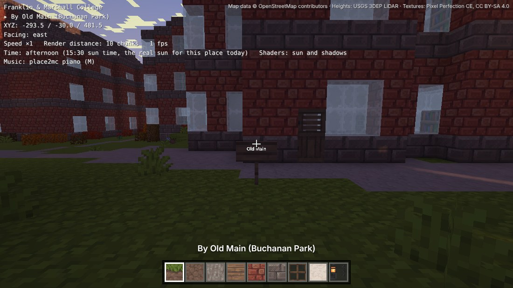
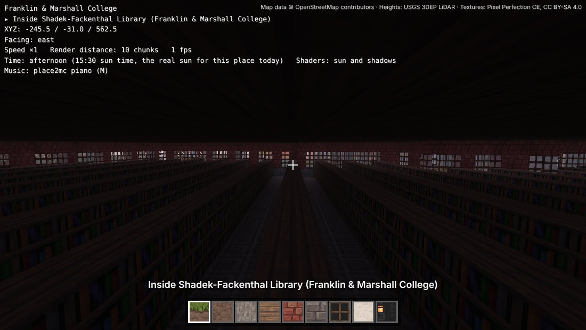

# Franklin & Marshall College

Franklin & Marshall College in Lancaster, Pennsylvania, built at 1 block = 1 metre from OpenStreetMap and the US
government's 2019 laser scan of the land (USGS 3DEP LiDAR): every roof at its measured height, metre by metre, with its
towers, cupolas, gables and chimneys; every tree where it stands, as tall and as wide as it is; the ground as scanned.
1.5 km x 1.5 km around the campus, Java and Bedrock.

**[Walk around it in your browser](https://raw.githack.com/AstroAli5/place2mc/main/examples/fandm/Walk%20around%20Franklin%20%26%20Marshall%20College.html)**
(about 4 MB; you start on the lawn in front of Old Main, looking at its tower).

## How it was made

1. `Get F&M data.html` (made by `tools/make_fetch_page.py`) ran in a browser: OpenStreetMap's map, and 11.4 million laser
   points of the 2019 scan `PA_Northcentral_B1_2019`, boiled down to `place2mc-data.json`.
2. `python place2mc.py --osm-file place2mc-data.json --lidar place2mc-data.json --center 40.04966,-76.31705 --radius 768
   --tags examples/fandm/fandm-tags.json --spawn 40.045252,-76.319681,270 --edition both`

## How exact it is

Heights, compared on every 1 m of roof of the 86 named buildings: 93.5% within 1 m of the laser scan (0.6 m on average;
Minecraft rounds to whole blocks). Old Main's tower: 36 blocks; the scan measures 36.0 m and the college archives give
121 ft (36.9 m). The Java world reads back with two libraries, and the Bedrock world block for block (78 million blocks,
0 wrong).

| Building | Laser scan 2019: roof middle / top 5% / highest (m) | In the world, blocks above the ground | Roof within 1 m of the scan |
|---|---|---|---|
| Old Main | 15.5 / 18.5 / 36.0 | 16 / 18 / 36 | 94% |
| Goethean Hall | 13.5 / 16.0 / 17.0 | 14 / 16 / 16 | 98% |
| Diagnothian Hall | 14.0 / 16.5 / 16.5 | 14 / 16 / 16 | 96% |
| Hensel Hall | 12.0 / 17.0 / 28.0 | 12 / 16 / 28 | 96% |
| Keiper Liberal Arts | 14.5 / 21.0 / 29.5 | 14 / 21 / 29 | 86% |
| Shadek-Fackenthal Library | 13.0 / 16.5 / 26.5 | 13 / 16 / 20 | 94% |
| Steinman College Center | 9.5 / 10.5 / 12.5 | 10 / 10 / 12 | 97% |
| Stager Hall | 16.5 / 20.5 / 23.0 | 16 / 20 / 22 | 93% |
| Harris Center for Business, Government & Public Policy | 14.5 / 17.0 / 21.5 | 14 / 17 / 19 | 89% |
| Hackman Physical Sciences Laboratory | 16.0 / 17.5 / 22.0 | 16 / 18 / 22 | 96% |
| Barshinginer Life Sciences Building | 17.5 / 22.0 / 27.0 | 18 / 22 / 27 | 90% |
| Martin Library of the Sciences | 13.0 / 16.0 / 18.5 | 13 / 16 / 16 | 95% |
| Mayser Physical Education Center | 11.0 / 14.0 / 17.5 | 11 / 14 / 15 | 95% |
| Alumni Sports and Fitness Center | 15.0 / 16.0 / 19.5 | 15 / 16 / 20 | 98% |
| Kunkel Aquatic Center | 10.0 / 11.5 / 16.0 | 10 / 12 / 14 | 98% |
| Robert Roschel Performing Arts Center | 7.5 / 10.5 / 11.0 | 8 / 10 / 11 | 95% |
| Roschel College House | 16.0 / 20.5 / 27.5 | 16 / 20 / 28 | 95% |
| Ware College House | 13.0 / 15.0 / 15.5 | 13 / 15 / 16 | 93% |
| Weis College House | 12.0 / 15.0 / 17.0 | 12 / 15 / 16 | 91% |
| Bonchek College House | 12.0 / 14.5 / 14.5 | 12 / 14 / 14 | 96% |
| Brooks College House | 9.0 / 11.0 / 15.0 | 9 / 11 / 16 | 93% |
| Schnader Residence Hall | 10.0 / 12.0 / 14.5 | 10 / 12 / 14 | 92% |
| Thomas Residence Hall | 11.5 / 12.0 / 17.5 | 12 / 12 / 16 | 97% |
| Meyran Hall | 10.0 / 12.5 / 23.5 | 10 / 12 / 23 | 86% |
| Dietz Hall | 10.0 / 12.5 / 14.5 | 10 / 12 / 19 | 87% |
| Distler House | 8.0 / 13.0 / 21.5 | 8 / 12 / 13 | 87% |
| North Museum of Nature and Science | 7.5 / 11.0 / 23.0 | 8 / 11 / 23 | 97% |
| Lombardo Welcome Center | 10.5 / 12.5 / 14.0 | 10 / 12 / 14 | 97% |
| Winter Visual Arts Center | built after the scan | 16 / 17 / 29 | from published facts |
| Harwood Commons | 7.0 / 9.0 / 22.0 | 7 / 9 / 17 | 91% |
| Klehr Center for Jewish Life | 8.0 / 11.7 / 23.0 | 8 / 9 / 11 | 81% |
| Santee Chapel | 10.0 / 29.0 / 32.5 | 10 / 28 / 32 | 93% |
| Lark Building | 15.5 / 20.5 / 33.0 | 16 / 20 / 33 | 93% |

The "highest" column can differ where a tree hangs over a roof (the tree is drawn, the branch is not part of the roof),
or where a mast or spire is thinner than the scan can see.

## Knowing where you are

The walk-through tells you where you are at the bottom of the screen: *Inside Shadek-Fackenthal Library*, *By Old Main*,
*On College Avenue*, *In Buchanan Park*, and in the top corner which named building you are looking at. In Java and
Bedrock every named building has a sign with its name in front of its main door (442 name and street signs in all).

## Inside the buildings

Every building is furnished for what it is used for, worked out from its name and tags: bookshelf rows and reading
tables in the libraries, pews facing an altar in Santee Chapel (Lancaster Theological Seminary, next door), seats facing a stage in Hensel Hall and the Roschel
Performing Arts Center, a pool with lanes in the Kunkel Aquatic Center, courts with bleachers in Mayser and the Alumni
Sports and Fitness Center, bedrooms off a corridor in the College Houses and residence halls (each with a bed, a desk
and a wardrobe, as F&M's housing pages describe its rooms), tables and a serving counter in the dining halls, display
cases in the North Museum, lab benches and fume cupboards in Hackman and Barshinger, desks facing a board in the
classroom buildings, offices elsewhere. The real floor plans are not public, so the layout of rooms is made up; what
each building is used for is not.

## What is checked, and what is not

- Colours: checked building by building on Google Earth's 3D view of the campus (May 2024) and on photos of Old Main,
  Diagnothian Hall, Stager Hall and Steinman College Center: red brick with mid-grey slate roofs, except the Lombardo
  Welcome Center (light walls, white flat roof) and the white flat roofs of Steinman College Center and College Row.
- Names: ten are spelt as on F&M's own campus map, not as on OpenStreetMap (Shadek-Fackenthal Library, Huegel Alumni
  House, Wohlsen House, Office of Multicultural Affairs, Barshinger Life Sciences & Philosophy Building, Kunkel Aquatic
  Center, Roschel College House (the former New College House), Restaurants at Ben Franklin (D-Hall), Keiper Liberal
  Arts, and the Harris Center for Business, Government & Public Policy).
- Since the 2019 scan: the Winter Visual Arts Center (2020) is built from published facts (3 storeys, 15 m: a two-storey
  frame of 16-foot glass units on a white concrete base); the Lombardo Welcome Center (2024) is the renovated College
  Square building the scan measured, with its new light walls. Other changes since 2019 were not checked building by
  building.
- Trees: in the walk-through the leaves turn with the real date (orange, red, yellow and brown in October and November,
  green in summer). Minecraft has no seasons, so in the Java and Bedrock worlds they stay green.
- Made up to look right: the layout of rooms, flowers, bushes, parked cars and most street lamps.
- Not opened in the real game: there is no Minecraft on the computer this was made with. Both worlds were read back
  block by block (Java with two libraries, Bedrock 78 million blocks, 0 wrong).

Sources: © OpenStreetMap contributors (ODbL); USGS 3D Elevation Program (public domain); F&M Archives (Old Main, building
names); F&M campus map; F&M housing pages (room furniture); Dezeen and The Architect's Newspaper (Winter Visual Arts
Center); Google Earth (colours, viewed only).
